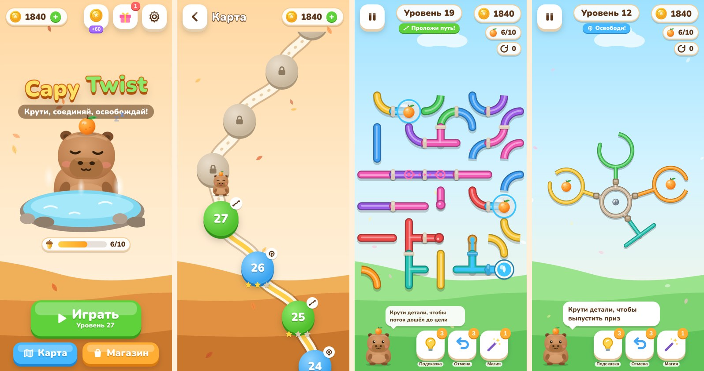
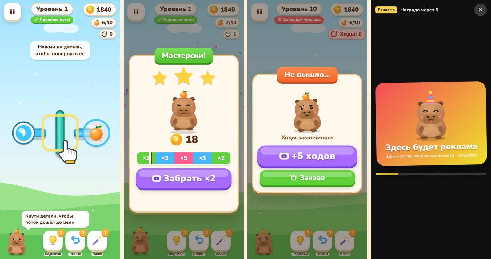
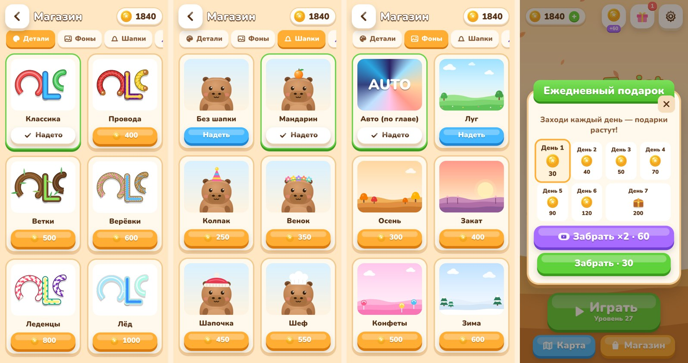
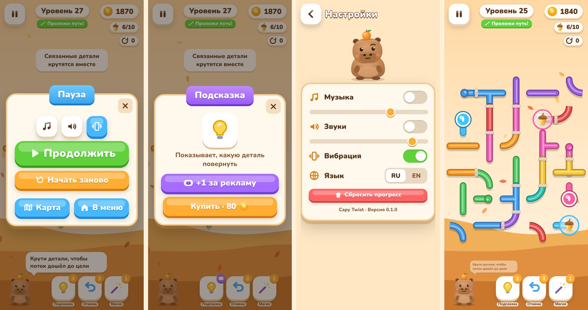
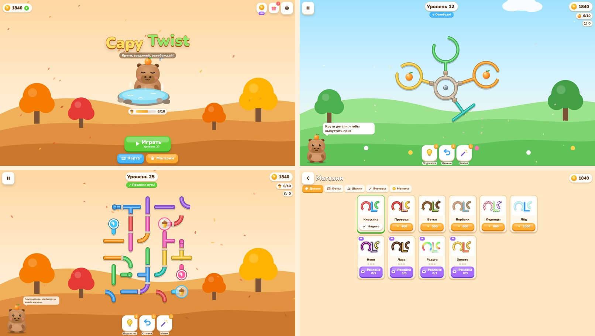
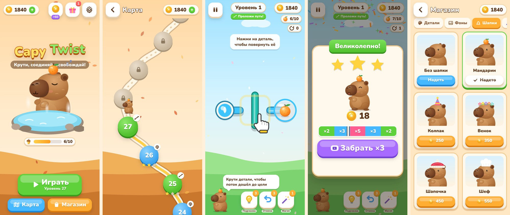
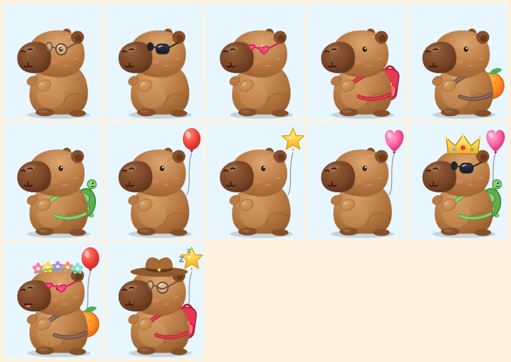
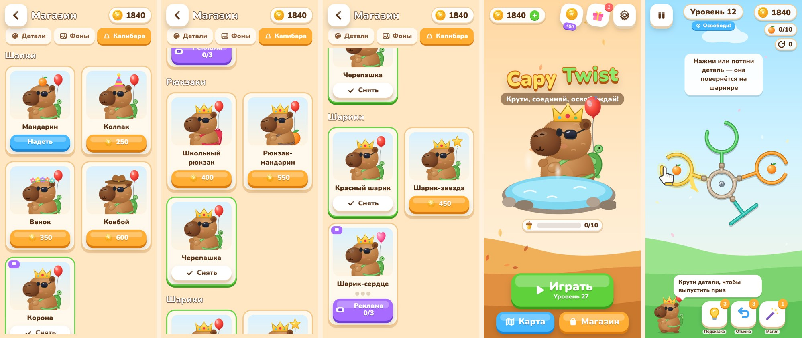

# Capy Twist 🦫🍊

Казуальная веб-головоломка для ПК и мобильных: крути детали, прокладывай путь потоку и освобождай призы вместе с капибарой.
Все ассеты (графика, музыка, звуки) генерируются кодом, внешних файлов нет.

## Запуск

```bash
npm install
npm run dev        # дев-сервер (http://localhost:5173)
npm run build      # проверка типов + production-сборка в dist/
npm run preview    # локальный просмотр сборки
npm test           # тесты генератора уровней (решаемость, детерминизм)
```

Сборка статическая (`dist/`), её можно выложить на любой хостинг или игровой портал (`base: './'`).

Полезные URL-параметры для разработки:
`?level=N` открывает уровень N, `?screen=map|shop|settings`, `&tab=hats` открывает вкладку магазина, `?adfail` имитирует ошибку рекламной сети.

## Игровые режимы

| Режим | Суть | Механики |
|---|---|---|
| **Проложи путь** (`path`) | Тап поворачивает деталь на 90°. Поток идёт от источника к цели и зажигает трубки | прямые, уголки, тройники, двойные дуги; зажимы; связанные детали; цветные потоки; бомбы с фитилём (их тушит поток); бонус-призы |
| **Освободи** (`free`) | Детали висят на шарнирах деревом. Тап или перетаскивание поворачивает деталь вместе со всем, что к ней прикреплено. При столкновении деталь отскакивает. Приз вылетает, когда открывается проход наружу | чашки, перекладины, крючки; «цветок» с хабом; кодовый замок из колец; зажимы (снимаются ключом); бомбы с фитилём |

Уровни 1–30 заданы вручную (`src/game/levels.ts`). С 31-го идёт бесконечная генерация:
- **детерминированный seed** по номеру уровня, так что уровень N у всех одинаковый;
- **гарантия решаемости**: путь строится как дерево потока с последующим перемешиванием, «Освободи» проверяется BFS-решателем (он же считает минимум ходов для звёзд и подсказок);
- **кривая сложности пилой**: каждый 5-й уровень даёт передышку, каждый 10-й — «Сложный» (лимит ходов и награда ×2);
- **главы по 20 уровней** со сменой фона, приза и музыки;
- генерация идёт в Web Worker, следующий уровень подгружается заранее.

## Структура

```
src/
  main.ts              загрузка, навигация, пауза при скрытии вкладки
  config.ts            экономика, реклама, каталог магазина, главы
  core/                save (localStorage), rng, tween, pause, guard (ПКМ/зум/выделение)
  audio/audio.ts       синтезатор + секвенсор (4 трека) и ~19 звуков на Web Audio
  ads/ads.ts           AdProvider, StubProvider (заглушка), AdManager (частота показов)
  game/
    path.ts, pathgen.ts      модель и генератор режима «Проложи путь»
    free.ts, freegen.ts      модель, коллизии, BFS-решатель и шаблоны режима «Освободи»
    levels.ts                ручные уровни, бесконечная генерация, кривая сложности
    pathboard.ts, freeboard.ts  отрисовка и ввод (PixiJS)
    loader.ts, gen.worker.ts генерация в Web Worker с префетчем
  render/              art (SVG: капибара, шапки, призы, иконки), skins (10 видов деталей),
                       backgrounds (8 тем), fx (частицы), textures, preview
  ui/                  экраны (menu, map, shop, settings, game), диалоги, награды, стили
  i18n/                RU / EN
```

**Стек:** TypeScript + Vite, PixiJS v8 для игрового поля (WebGL), HTML/CSS для интерфейса.

## Реклама

Пока стоит заглушка `StubProvider`: полноэкранный оверлей с таймером. Чтобы подключить настоящую сеть, реализуйте интерфейс `AdProvider` из `src/ads/ads.ts`:

```ts
class MyNetwork implements AdProvider {
  name = 'my-network';
  async init() { /* загрузка SDK */ }
  async showInterstitial() { /* резолв после закрытия */ }
  async showRewarded() { /* true, если награда заработана */ }
}
await Ads.init(new MyNetwork());   // в src/main.ts
```

`AdManager` сам делает всё остальное:
- **на время показа** ставит на паузу игровой цикл, анимации и звук (плавный фейд и `AudioContext.suspend`), блокирует ввод;
- **частота межстраничной рекламы** задаётся в `AD_CONFIG` (`src/config.ts`): с 3-го пройденного уровня, кулдаун 40 с, каждый 2-й рестарт, выход из уровня, возврат во вкладку после 90 с;
- **места показа rewarded**: множитель награды ×2/×3/×5 после победы, «+5 ходов» и «заморозка бомбы» при поражении, бустеры (+1), скины, фоны и шапки за 3 просмотра, бесплатные монеты (и пак 3/3), ежедневный подарок ×2, сундук ×2, предложение палочки на сложных уровнях.

На странице отключены контекстное меню, правая кнопка мыши, выделение, перетаскивание, pinch-zoom, двойной тап и Ctrl+колесо.

## Магазин и прогресс

- **10 скинов деталей**: классика, провода, ветки, верёвки, леденцы, лёд; за рекламу 3/3 — неон, лава, радуга, золото.
- **9 фонов**: авто (по главе), луг, осень, закат, конфеты, зима, ночь; за рекламу — подводный мир и космос.
- **Наряд капибары** (4 слота, носятся одновременно): шапки (мандарин, колпак, венок, ковбой; корона за рекламу), очки (умные, солнечные; сердечки за рекламу), рюкзаки (школьный, мандарин; черепашка за рекламу), воздушные шарики (красный, звезда; сердце за рекламу).
- **5 бустеров**: подсказка, отмена хода, волшебная палочка, ключ, заморозка.
- **Корзинка призов**: каждые 10 призов открывают сундук.
- **Ежедневный подарок**: 7-дневная серия.

Прогресс хранится в `localStorage` (`capytwist.save.v1`).

## Скриншоты и автопроверка

`scripts/shots.mjs` прогоняет сценарии в headless Chromium (Playwright): экраны, уровни, прохождение, поражение с продолжением за рекламу, диалоги.

```bash
npm run build && npx vite preview --port 4173 &
DEV=phone node scripts/shots.mjs http://localhost:4173/ shots menu,levels,play
```

## Скриншоты









